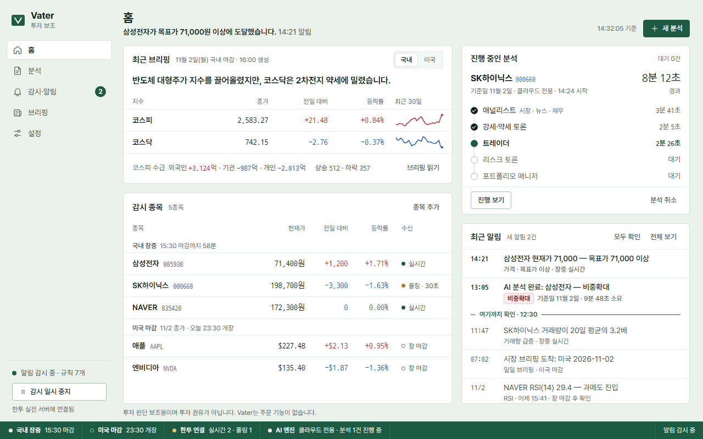
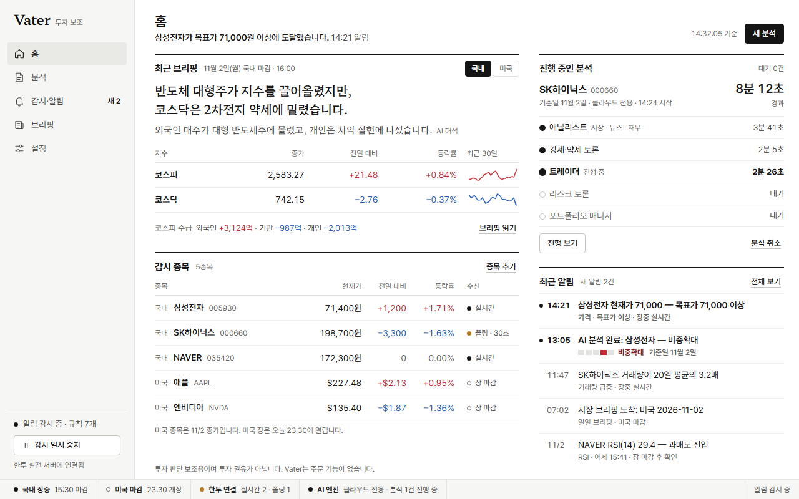
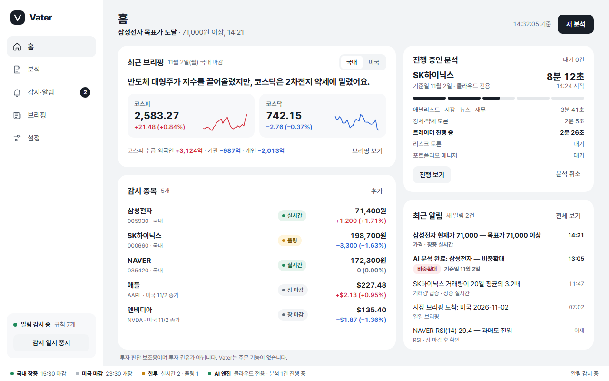

# 디자인 방향 시안 (ui/design-system 1단계)

시각 방향 3개를 **같은 홈 화면**으로 그려 비교합니다. 이 중 하나를 고르면, 그 방향으로 디자인 토큰과 컴포넌트(`apps/desktop/src/design-system`)를 만듭니다. 이 단계에서는 아직 토큰과 컴포넌트를 만들지 않습니다.

- 제품 기록: 저장소 루트 [`PRODUCT.md`](../../../PRODUCT.md) (impeccable `init` 형식. 사용자, 목적, 제약, 원칙)
- 시안 파일: 브라우저로 여세요. 위쪽 1280×800이 앱 홈 화면이고, 아래쪽은 팔레트, 글꼴, 결정 배지, 수신 상태, 오프라인 배너 견본입니다.
  - [`a-passbook.html`](a-passbook.html) · [`b-research-note.html`](b-research-note.html) · [`c-fintech-standard.html`](c-fintech-standard.html)
  - 캡처: [`shots/`](shots/) (Windows Chrome으로 1280×800에서 찍은 실제 화면)
- **예시 데이터입니다.** 장면은 2026-11-03(화) 14:32, 국내 장중입니다. 시세, 브리핑 문장, 알림은 모두 지어낸 값이고, 알림 문구 형식만 `alerts/rules.py`, `briefing/service.py`의 실제 형식을 따랐습니다.

| A · 통장 정리 | B · 리서치 노트 (추천) | C · 금융 앱 표준 |
|---|---|---|
|  |  |  |

## 한눈에 비교

| | A · 통장 정리 | B · 리서치 노트 | C · 금융 앱 표준 |
|---|---|---|---|
| 한 줄 | 지난번 확인한 곳부터 이어 읽는 통장 | AI가 쓴 문장과 데이터가 그린 숫자를 글꼴로 나눈 리포트 | 국내 금융 앱에서 익숙한 그대로 |
| 바탕 | 옅은 민트 속지 + 흰 카드(1px 선) | 흰 종이, 칸막이 없이 굵은 먹선으로 구역 | 회색 바탕 + 모서리 20px 흰 카드 |
| 셸 색 | 짙은 초록(상태 표시줄, 주 버튼, 진행 중) | 없음(먹색만) | 없음(먹색 주 버튼, 실시간만 초록) |
| 글꼴 | Pretendard + 나눔고딕코딩(모든 숫자) | Pretendard + 함렛 Hahmlet(AI 문장만) | Pretendard 하나, 굵기로 위계 |
| 밀도 | 중간. 행 40px, 본문 14px | 중간, 읽기 여유. 행 40px, AI 문장 20px | 여유. 2줄 행 52px, 숫자 굵게 |
| 숫자 | 고정폭 인자체(통장 숫자) | 고정폭 숫자(tnum), 보통 굵기 | 고정폭 숫자(tnum), 굵게 |
| 결정 배지 | 옅은 바탕 사각 태그 | 5칸 **의견 눈금**(왼쪽 매도 → 오른쪽 매수) | 옅은 바탕 알약 |
| 고유한 장치 | **확인선**: "여기까지 확인 · 12:30" | **AI 문장은 명조, 숫자는 고딕** | 없음(익숙함이 장점) |
| 위험 | 초록이 해외 앱의 "상승"으로 읽힐 수 있음. 고정폭 숫자가 딱딱해 보일 수 있음 | 서체 2종이라 앱 용량이 늘어남. 색이 적어 밋밋하다고 느낄 수 있음 | 다른 앱과 구별되지 않음. 큰 카드 때문에 같은 화면에 담기는 정보가 가장 적음 |

## 어느 방향이든 지키는 공통 규칙

- **빨강과 파랑은 시세 방향에만 씁니다.** 상승 빨강, 하락 파랑(미국 종목도 같음). 그래서 오류, 끊김, 오프라인, 폴링, 검토 필요는 **황토색**과 글자로 표시합니다. 빨간 오류 표시는 쓰지 않습니다.
- **색만으로 구분하지 않습니다.** 변화에는 항상 부호(+, −)를 붙이고, 결정과 상태에는 글자를 함께 씁니다. 변화가 0이면 회색 `0`, `0.00%`입니다.
- **숫자 표기:** `71,400원`, `+1,200`, `+1.71%`, `$227.48`, `+$2.13`. 숫자 열은 오른쪽 정렬하고 고정폭 숫자를 씁니다(Pretendard의 `tabular-nums`가 실제로 동작하는 것을 확인함).
- **결정 배지:** 매수·비중확대는 빨강 계열, 비중축소·매도는 파랑 계열, 보유는 먹색, 검토 필요는 황토색입니다(국내 HTS 관례). 주문 버튼처럼 보이지 않도록 **진하게 채운 버튼 모양은 쓰지 않고** 옅은 바탕에 글자로만 둡니다.
- **한국어 줄바꿈:** `word-break: keep-all`로 낱말 중간에서 줄이 바뀌지 않게 합니다.
- 그림자, 그라데이션, 유리 효과는 쓰지 않습니다. 면은 1px 선이나 한 단계 다른 바탕색으로 나눕니다.
- 글꼴은 **앱에 포함**합니다(오프라인). 시안은 미리보기용으로 CDN에서 받습니다. 세 글꼴 모두 SIL OFL 1.1이라 앱에 넣어 배포할 수 있습니다.
- 모든 글자와 바탕 조합이 WCAG AA(4.5:1) 이상입니다(아래 "확인한 것").

---

## A · 통장 정리

**왜 이 사용자에게 맞나.** 한국 성인이라면 누구나 통장을 들고 은행에 가서 "통장 정리"를 해 본 적이 있습니다. 밀린 거래가 지난번 찍힌 줄 다음부터 이어서 인쇄되고, 그 줄이 곧 "여기까지는 봤다"는 표시입니다. Vater는 하루 대부분 트레이에 숨어 감시하다가 사용자가 가끔 창을 열면 "그동안 무엇이 바뀌었나"를 보여줘야 하는 앱이고, 알림은 상태가 바뀔 때만 보냅니다(D7). 그래서 알림 목록에 **확인선**을 그어, 새로 생긴 것과 이미 본 것을 한눈에 나눕니다. 통장 속지의 옅은 민트 바탕과 표지의 짙은 초록은 빨강·파랑과 겹치지 않는 색이라, 시세의 빨강과 파랑이 화면에서 가장 또렷하게 남습니다. 숫자는 통장에 찍히는 고정폭 숫자처럼 자리가 딱 맞게 정렬됩니다.

**팔레트 (라이트)**

| 토큰 | 값 | 쓰는 곳 |
|---|---|---|
| `--ground` | `#eaf2ec` | 앱 바탕, 사이드바 (통장 속지) |
| `--sheet` | `#ffffff` | 카드 |
| `--sheet-2` | `#f3f8f4` | 눌림·호버, 세그먼트 바탕 |
| `--line` / `--rule` / `--control` | `#d3e0d7` / `#e6eee9` / `#a9bdb1` | 카드 테두리 / 행 구분선 / 입력·버튼 테두리 |
| `--ink` / `--ink-2` / `--ink-3` | `#102019` / `#43544b` / `#56665d` | 글자 3단계 (흰 바탕 16.9 / 8.1 / 6.1:1) |
| `--cover` | `#1d5a43` | 표지색: 상태 표시줄, 주 버튼, 진행 중 단계, 확인선 |
| `--up` / `--up-bg` / `--up-ink` | `#c42a2f` / `#fdecec` / `#8c1d21` | 상승 (흰 바탕 5.7:1) |
| `--down` / `--down-bg` / `--down-ink` | `#1e58c0` / `#e9f0fc` / `#163f8a` | 하락 (흰 바탕 6.5:1) |
| `--warn` / `--warn-bg` / `--warn-ink` | `#b7791f` / `#fff3d6` / `#6f4600` | 폴링, 검토 필요, 끊김, 오프라인 |

- **글꼴:** Pretendard(화면 글자) + 나눔고딕코딩 Nanum Gothic Coding(모든 숫자, 시각, 종목 코드). 나눔고딕코딩은 한글이 들어 있는 고정폭 글꼴이라 `원`까지 같은 글꼴로 찍힙니다. 대안은 D2Coding.
- **밀도:** 중간. 행 40px, 본문 14px, 카드 안쪽 여백 16px, 모서리 6px.
- **배지·알림·차트:** 결정 배지는 높이 20px 사각 태그. 알림은 "시각 | 내용 / 종류·확인 시점" 두 줄 행이고, 새 알림은 시각을 굵게 씁니다. 미니 차트는 1.5px 선 하나에 끝점만 찍고, 그날 방향의 색(상승 빨강, 하락 파랑)을 씁니다. 수신 상태는 점 + 글자(실시간 초록 점, 폴링 황토 점, 장 마감 빈 원, 끊김 굵은 황토 원).
- **다크(선택):** 표지 초록을 바탕 쪽으로 끌어내린 짙은 녹흑 바탕을 생각할 수 있으나, 이번 시안에서는 그리지 않았습니다.

**다른 후보에서 가져온 규율** (impeccable 도전 후보 6개는 모두 이 방향보다 사용자와 제품에 덜 맞아 탈락했고, 각각에서 규율 하나씩만 가져왔습니다)

- 이케다 료지의 데이터 화면에서: **색은 두 가지 뜻만.** 빨강·파랑은 시세 방향, 초록은 셸과 진행 중. 나머지는 모두 먹색.
- 개발자 콘솔에서: **패널은 제자리에, 위험한 버튼은 떨어뜨려.** 홈의 구역 배치는 바뀌지 않고, "분석 취소"는 "진행 보기"에서 멀리 오른쪽 끝에 둡니다.
- 오리엔티어링 지도에서: **지금 진행 중인 하나에만 표시색.** 분석 타임라인에서 초록은 진행 중 단계에만 씁니다.
- 음반 카탈로그 디자인에서: **종목 코드는 늘 같은 자리.** 이름 바로 뒤, 같은 고정폭 글꼴, 같은 회색.
- 크라우얼의 격자에서: **격자 산수.** 600 + 16 + 416 = 1032px처럼 칸 너비가 정확히 맞고, 한 카드 안의 숫자는 오른쪽 끝선 하나에 맞춥니다.
- 카세트테이프 속지에서: **국내 면과 미국 면.** 감시 종목을 국내와 미국으로 나누고, 각 묶음 머리에 그 시장의 시계("15:30 마감까지 58분", "오늘 23:30 개장")를 붙입니다.

---

## B · 리서치 노트 (추천)

**왜 이 사용자에게 맞나.** 국내 개인 투자자는 증권사 리서치 리포트를 읽는 데 익숙합니다. 첫 장에 투자의견과 핵심 요약이 있고, 숫자는 표에 정리되어 있습니다. Vater가 주는 것도 결국 읽을거리입니다. AI 분석 리포트, 3줄 요약, 일일 브리핑 문장이 그렇습니다. 이 방향은 **AI가 쓴 문장만 명조(함렛)로, 데이터에서 나온 숫자와 화면 글자는 고딕(Pretendard)으로** 씁니다. 스펙 D9("브리핑의 숫자는 LLM이 쓰지 않는다")과 원칙 "숫자는 데이터에서 나온다"를 글꼴로 눈에 보이게 만든 것입니다. 사용자는 문장을 읽다가도 "이건 AI의 해석이고, 저 숫자는 데이터"라는 것을 설명 없이 구분할 수 있습니다. 결정 배지는 매도에서 매수까지 5칸 **의견 눈금**으로 그려, 결정이 다섯 단계 중 어디쯤인지를 위치로 보여주고, "검토 필요"는 눈금 밖(빈 칸)으로 따로 둡니다. 크롬에 색을 쓰지 않으므로 빨강과 파랑이 화면에서 시세 방향 하나의 뜻만 가집니다. 매매 앱이 아니라 판단을 돕는 문서라는 인상을 줍니다.

**팔레트 (라이트)**

| 토큰 | 값 | 쓰는 곳 |
|---|---|---|
| `--paper` | `#ffffff` | 앱 바탕, 본문 |
| `--side` | `#f6f6f4` | 사이드바, 상태 표시줄 |
| `--tint` / 선택 | `#f1f1ee` / `#e9e9e5` | 호버 / 사이드바 현재 위치 |
| `--line` / `--rule` / `--control` | `#e2e2de` / `#ececE8` / `#c4c4bf` | 표 머리 아래선 / 행 구분선 / 버튼 테두리 |
| `--ink` | `#141414` | 글자, 주 버튼, 구역 위 2px 먹선, 세그먼트 선택 |
| `--ink-2` / `--ink-3` | `#474745` / `#5f5f5c` | 보조 글자 (흰 바탕 9.3 / 6.4:1) |
| `--up` / `--up-bg` / `--up-ink` | `#c62a2f` / `#fcebeb` / `#8d1c20` | 상승 (5.6:1) |
| `--down` / `--down-bg` / `--down-ink` | `#1d57bf` / `#e8effb` / `#163e88` | 하락 (6.6:1) |
| `--warn` / `--warn-bg` / `--warn-ink` | `#b7791f` / `#fff4d8` / `#6f4600` | 폴링, 검토 필요, 끊김, 오프라인 |

- **글꼴:** Pretendard(화면, 숫자, 고정폭 숫자) + 함렛 Hahmlet(AI가 쓴 문장과 워드마크만). 함렛은 Hypertype의 현대 한글 명조이며 굵기 가변 글꼴입니다. 대안은 Noto Serif KR.
- **밀도:** 중간, 읽기 여유. 카드 상자 없이 구역 위 2px 먹선과 여백으로 나눕니다. 행 40px, 본문 14px, 브리핑 첫 문장 20px.
- **배지·알림·차트:** 결정은 의견 눈금(5칸 × 10px). 새 알림은 앞에 먹색 점과 굵은 글자. 미니 차트는 A와 같이 선 하나. 버튼은 먹색 채움 하나(주 버튼)와 밑줄 글자 버튼.
- **다크(선택):** 종이·먹 관계를 뒤집은 짙은 회색 바탕을 생각할 수 있으나, 이번 시안에서는 그리지 않았습니다.

---

## C · 금융 앱 표준

**왜 이 사용자에게 맞나.** 국내 금융 앱(증권, 은행)에서 이미 익숙한 문법을 그대로 따릅니다. 회색 바탕 위 둥근 흰 카드, 이름과 코드를 위아래로 쓴 2줄 목록, 크고 굵은 숫자, 알약 모양 상태 표시입니다. 처음 보는 사람도 어디를 눌러야 하는지 바로 압니다. 다만 특정 회사의 브랜드 색(파랑 계열)은 하락 색과 겹치므로 쓰지 않고, 주 버튼은 먹색입니다. 이 방향은 비교를 위한 "익숙한 길"입니다. 고르면 함께 둘 앱 2~3개를 정해서 그 완성도를 기준으로 삼습니다.

**팔레트 (라이트)**

| 토큰 | 값 | 쓰는 곳 |
|---|---|---|
| `--ground` / `--card` / `--well` | `#f2f4f6` / `#ffffff` / `#f7f8fa` | 바탕 / 카드 / 카드 안 칸 |
| `--line` | `#e5e8eb` | 상태 표시줄 위 선 |
| `--ink` / `--ink-2` / `--ink-3` | `#191f28` / `#4e5968` / `#5f6b7a` | 글자 (흰 바탕 16.6 / 7.1 / 5.4:1, 회색 바탕 위 `--ink-3` 4.9:1) |
| `--primary` | `#191f28` | 주 버튼 |
| `--live` | `#1f8a5b` | 실시간, 감시 중 |
| `--up` / `--up-bg` / `--up-ink` | `#d42f3c` / `#fdeced` / `#a1202b` | 상승 (4.9:1) |
| `--down` / `--down-bg` / `--down-ink` | `#2862d6` / `#eaf1fd` / `#1c48a0` | 하락 (5.5:1) |
| `--warn` / `--warn-bg` / `--warn-ink` | `#c58411` / `#fff5dc` / `#7a4f00` | 폴링, 검토 필요, 오프라인 |

- **글꼴:** Pretendard 하나. 제목 24/800, 카드 제목 17/700, 숫자 15~21px 굵게.
- **밀도:** 여유. 카드 안쪽 여백 20px, 목록 행 52px, 모서리 카드 20 / 안쪽 칸 14 / 버튼 10px.
- **배지·알림·차트:** 결정 배지와 수신 상태 모두 옅은 바탕 알약. 브리핑은 지수마다 칸 하나(숫자 크게 + 미니 차트). 분석 진행은 5칸 진행 막대 + 단계 목록.
- **다크(선택):** 이런 앱들이 흔히 제공하는 짙은 남색이 아닌 무채색 다크로 할 수 있으나, 이번 시안에서는 그리지 않았습니다.

---

## 추천: B · 리서치 노트

1. **제품의 핵심이 읽을거리입니다.** 홈 외의 주요 화면(분석 결과, 에이전트별 보고서, 브리핑 상세)은 모두 긴 글을 읽는 화면입니다. B는 읽기에 맞춘 방향이라 홈보다 이 화면들에서 더 큰 차이를 냅니다.
2. **"숫자는 데이터에서"를 설명 없이 보여줍니다.** AI 문장은 명조, 숫자는 고딕이라는 규칙 하나가 D9과 면책의 정신(판단 보조, 권유 아님)을 화면 전체에서 지킵니다. 이 장치는 다른 투자 앱이 그대로 가져갈 수 없는, Vater만의 사실에서 나왔습니다.
3. **결정을 단계로 보여줍니다.** 의견 눈금은 "비중확대"를 "매수"와 다른 것으로, "검토 필요"를 판단 불가로 정직하게 보여줍니다. 색 배지만으로는 매수와 비중확대가 거의 같아 보입니다(A, C의 견본 참고).
4. **색의 뜻이 하나뿐입니다.** 크롬에 색이 없어 빨강·파랑이 시세 방향으로만 읽힙니다.

B의 약점과 대응: 함렛 가변 TTF가 약 3.4MB이므로, 구현할 때 woff2로 바꾸고 쓰는 글자만 남기면(서브셋) 줄일 수 있습니다. 색이 적어 차분하다 못해 밋밋하게 느껴진다면, 그것이 고를 때 판단할 지점입니다. 그리고 **A의 확인선은 모양이 아니라 동작**(마지막으로 본 시점 이후의 알림을 나눔)이므로, B를 고르더라도 B의 모양(먹색 선, 글자)으로 가져올 수 있습니다.

A는 홈 화면만 놓고 보면 가장 완성도가 높고 고유한 장치(확인선)가 분명합니다. 감시와 알림을 더 중요하게 본다면 A가 맞습니다.

---

## 어떻게 만들었나

- **impeccable `init`** → `PRODUCT.md`. 이 작업은 질문 도구가 없는 하위 에이전트로 진행해서 사용자에게 묻지 못했습니다. 그래서 스펙에서 확인한 사실만 쓰고, 추론한 내용은 `[추론]`으로 표시했습니다. 읽고 틀린 곳을 고쳐 주세요.
- **impeccable `shape` / `concept-seed`** (operate 모드, `seed:dec9020c26fa0839`). 사용자의 세계에서 고른 후보 7개를 공감도 순으로 세웠습니다. ① 증권사 리서치 리포트 ② 서울 지하철 노선도(분석 단계를 역으로) ③ 결재 서류의 결재란과 도장 ④ 경제신문 증권면 시세표 ⑤ 바둑 기보와 대국 해설(강세·약세 토론) ⑥ 은행 통장 ⑦ 일기예보. 주사위가 ⑥을 배정해 **A**가 되었고, 내 1순위 ①은 **B**(impeccable's pick)로 함께 냈습니다. 함께 뽑힌 도전 후보 6개(이케다 료지 데이터 화면, 다크 개발자 콘솔, 오리엔티어링 지도, Factory 레코드 카탈로그, 크라우얼 격자, 카세트 속지)는 모두 탈락했고, 각각의 규율 하나를 A에 반영했습니다(위 목록). **C**는 impeccable이 늘 함께 주는 "범주 표준" 선택지입니다.
- **taste-skill `design-taste-frontend`** (앱 화면 규칙): `draw.mjs --app --kind markets`가 achromatic-ledger, framed-sheet, pastel-consumer 스타일을 뽑았습니다. B는 achromatic-ledger(크롬에 색 없음)의 규율을, C는 pastel-consumer의 부드러운 모서리를 따릅니다. 하우스 규칙(그라데이션·그림자·글로우 금지, 숫자 오른쪽 정렬, 지어낸 지표 금지)을 세 시안에 모두 적용했습니다.
- **ui-ux-pro-max**: `--design-system` 추천은 "다크 OLED + 초록 상승 + IBM Plex"였습니다. 국내 관례(상승 빨강)와 정면으로 충돌하고 이 범주에서 가장 흔한 모습이라 받지 않았습니다. 대신 접근성 규칙(color-not-only, number-tabular, 대비 4.5:1)과 차트 규칙(선 차트는 한 계열, 색만으로 구분하지 않기)을 따랐습니다.

## 확인한 것과 못 한 것

- **눈으로 확인함:** WSL에는 브라우저가 없지만 Windows에 설치된 Chrome을 headless로 실행해(별도 임시 프로필, 설치 없음) 1280×800 캡처를 찍고 직접 보았습니다. 여러 번 고쳐 찍으며 넘침, 잘림, 낱말 중간 줄바꿈, 빈 띠를 고쳤습니다. 아래쪽 견본(팔레트, 배지, 배너)도 캡처로 확인했습니다. 글꼴 3종이 실제로 로드되는 것과 Pretendard의 고정폭 숫자가 동작하는 것도 캡처로 확인했습니다.
- **대비:** 위 표의 모든 글자·바탕 조합을 계산해 WCAG AA(4.5:1) 이상인 것을 확인했습니다.
- **자동 검사:** taste-skill `lint.mjs --app`: FAIL 0, WARN 1(알림 문구의 em dash. `alerts/rules.py`의 실제 형식이라 그대로 둠). impeccable `detect`: 지적 없음.
- **못 한 것:** 실제 Tauri WebView2 안에서의 표시, Windows 배율 125%·150%, 1280×800보다 작은 창, 키보드만으로 이동, 다크 테마, 앱에 넣을 Pretendard 파일 크기 측정.

## 스펙에서 시각 디자인 관점으로 애매한 점

1. **국내 지수 미니 차트의 데이터가 없습니다.** 브리핑 수집 데이터에서 미국 지수는 최근 종가 30개(`closes`)가 있지만, 국내 지수는 `{value, change, change_pct}`뿐입니다. 시안의 코스피·코스닥 30일 선은 지어낸 것입니다. 국내도 최근 종가를 모으도록 `core/briefing`을 고치거나, 국내는 이미 있는 상승·하락 종목 수(`advancers`, `decliners`)를 막대로 그리는 것 중에서 정해야 합니다.
2. **결정 배지 색.** 매수=빨강, 매도=파랑은 HTS 관례지만 상승·하락 색과 같고 주문 버튼을 떠올리게 합니다. 시안은 옅은 바탕 + 글자로 타협했습니다. 결정에 색을 쓸지 여부를 정해야 합니다.
3. **오류 색.** 빨강을 상승에 쓰므로 오류·끊김·오프라인을 황토색으로 정했습니다. 스펙에 정해진 것이 없습니다.
4. **장 외 시간의 수신 상태.** 스펙의 수신 상태는 실시간/폴링/끊김 세 가지인데, 미국 장이 닫힌 낮 시간의 미국 종목에는 "장 마감"이 필요합니다. 이때 보여줄 가격(직전 정규장 종가)과 프리·애프터마켓 표시 여부도 정해지지 않았습니다.
5. **알림 문구의 숫자 표기.** 저장되는 알림 문구는 "현재가 71,000"처럼 "원"이 없지만, 스펙 9-1은 원화에 "원"을 붙이라고 합니다. 문구를 그대로 보여줄지, 화면에서 다시 쓸지 정해야 합니다.
6. **홈의 "최근 브리핑".** 국내(16:00)와 미국(07:00) 중 무엇을 먼저 보여줄지. 시안은 탭으로 두고 국내를 골라 둔 상태입니다.
7. **면책 문구 위치.** 스펙은 "결과 화면마다"라고 합니다. 시안은 홈 아래에도 한 줄 두었습니다.
8. **상태 표시줄의 AI 엔진 상태.** "프리셋, 로컬 모델 동작 여부"인데 클라우드 전용일 때 무엇을 보여줄지(제공자? 모델명?) 정해지지 않았습니다.
9. **최소 창 크기, 배율, 다크 테마 제공 여부**가 스펙에 없습니다. 시안은 1280×800, 라이트만 그렸습니다.
